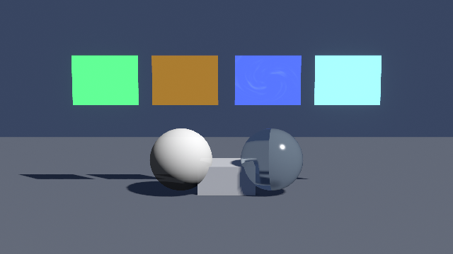
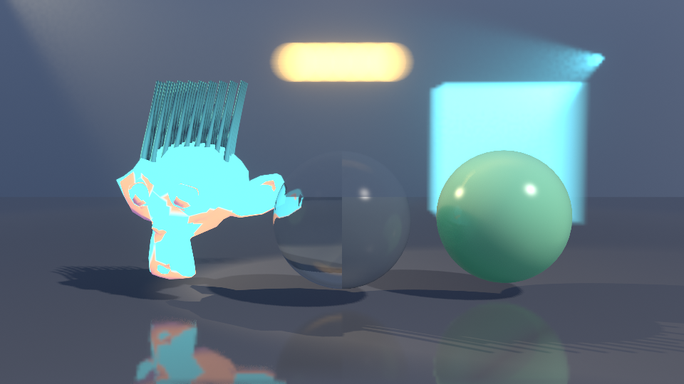

<!--
Keep this document short & concise,
linking to external resources instead of including content in-line.
See 'release/text/readme.html' for the end user read-me.
-->

Blender
=======

Blender is the free and open source 3D creation suite.
It supports the entirety of the 3D pipeline—modeling, rigging, animation, simulation, rendering, compositing,
motion tracking and video editing.

## Goo Engine 5.2.4 LTS (`goo-port`)

This branch ports **Goo Engine** (`GOO_ENGINE`) onto **Blender 5.2.4 LTS**. Portable builds for **macOS arm64** (`.dmg`), **Windows x64** (`.zip`), and **Linux x64** (`.tar.xz`) are published under [GitHub Releases (`v5.2.4-goo`)](https://github.com/Hassan5117/blender/releases/tag/v5.2.4-goo).

## Verification Evidence Screenshots

Automated verification runs [`tests/python/goo_engine_ci_test.py`](tests/python/goo_engine_ci_test.py) across every supported platform and GPU backend (covering Goo 3.5 / 4.4 / stock 4.x `.blend` migration, all 13 Goo shader nodes, Bloom, GTAO, SSR + Refraction, SSS, Volumetrics, DoF, Motion Blur, Planar/Sphere/Volume LightProbes, Hair Curves, Light Groups, and stock `BLENDER_EEVEE` sanity):

| Platform / Backend | Goo 3.x/4.x Compat & 13 Nodes (`goo44_compat`) | Multi-Effect Showcase (`master_showcase`) |
| :--- | :---: | :---: |
| **macOS arm64 — Metal** |  |  |
| **Windows x64 — OpenGL (`llvmpipe`)** |  |  |
| **Windows x64 — Vulkan (`lavapipe`)** |  |  |
| **Linux x64 — OpenGL (`llvmpipe`)** |  |  |
| **Linux x64 — Vulkan (`lavapipe`)** |  |  |

Project Pages
-------------

- [Main Website](https://www.blender.org)
- [Reference Manual](https://docs.blender.org/manual/en/latest/index.html)
- [User Community](https://www.blender.org/community/)

Development
-----------

- [Build Instructions](https://developer.blender.org/docs/handbook/building_blender/)
- [Code Review & Bug Tracker](https://projects.blender.org)
- [Developer Forum](https://devtalk.blender.org)
- [Developer Documentation](https://developer.blender.org/docs/)

License
-------

Blender as a whole is licensed under the GNU General Public License, Version 3.
Individual files may have a different but compatible license.

See [blender.org/about/license](https://www.blender.org/about/license) for details.
